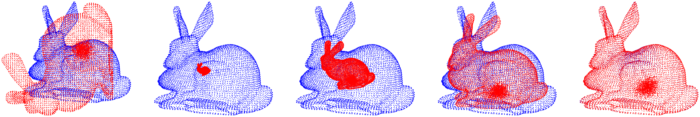

# DET/BCPD — Bayesian Registration for Functions and Point Sets

Open-source software for probabilistic registration of point sets and functions defined on irregular domains.

**Domain Elastic Transform (DET)** jointly aligns geometry and high-dimensional functional signals without requiring voxelization or binning. Applications include spatial transcriptomics, images, and audio.

**Bayesian Coherent Point Drift (BCPD)** aligns point clouds by estimating probabilistic correspondences and smooth, non-rigid deformations. Applications include shape analysis, 3D reconstruction, and shape transfer.

Both methods support accelerated variants, **DET++** and **BCPD++**, for large datasets.

[**DET Paper (TPAMI)**](https://www.computer.org/csdl/journal/tp/5555/01/11692358/2jNDMvwi9UY) |
[**arXiv**](https://arxiv.org/abs/2603.21235) |
[**26-second DET video**](https://youtube.com/shorts/ChT4lY4RVSM) |
[**Tutorial**](https://www.dropbox.com/scl/fi/tfd8tsscii9g7pkrndemi/bcpd-det-gentle-tutorial.pdf?rlkey=ssudpy9wyniousjccd04yr5ph&dl=0) |
[**Quick Reference (2 pages)**](https://www.dropbox.com/scl/fi/i3fryj4fvuqyrpz6gfcl8/bcpd-det-quick-reference.pdf?rlkey=k4uzdqda8emkr79jvsoe9v47n&dl=0) |
[**Quick Start**](#quick-start) |
[**Methods**](#methods)


This repository provides a software suite for several related registration problems:

- **DET / DET++** - function registration on irregular domains
- **BCPD / BCPD++** - probabilistic non-rigid point-set registration
- **GBCPD / GBCPD++** - surface-aware point-set registration
- **DLD / DLD++** - statistical shape-model fitting

The `++` variants use downsampling and displacement-field interpolation to improve scalability.

## News

- **13 Oct 2026:** Released DET/BCPD version 0.99 with improved handling of erroneous inputs.
- **13 Oct 2026:** Released an updated DET/BCPD README and a new [illustrated DET/BCPD tutorial](https://www.dropbox.com/scl/fi/tfd8tsscii9g7pkrndemi/bcpd-det-gentle-tutorial.pdf?rlkey=ssudpy9wyniousjccd04yr5ph&dl=0) with a [two-page quick reference](https://www.dropbox.com/scl/fi/i3fryj4fvuqyrpz6gfcl8/bcpd-det-quick-reference.pdf?rlkey=k4uzdqda8emkr79jvsoe9v47n&dl=0).
- **15 Sep 2026:** [Domain Elastic Transform (DET)](https://www.computer.org/csdl/journal/tp/5555/01/11692358/2jNDMvwi9UY) was published in *IEEE Transactions on Pattern Analysis and Machine Intelligence (TPAMI)*.
- **22 Mar 2026:** The DET preprint was released on [arXiv](https://arxiv.org/abs/2603.21235).
- **18 Mar 2025:** Initial DET code was released ([initial commit](https://github.com/ohirose/bcpd/tree/616b4c5e4e28ac598bcf770a9b231d55a97c2e71)).

## Contents

- [Citation](#citation)
- [Methods](#methods)
- [Installation](#installation)
- [Quick Start](#quick-start)
- [Demos](#demos)
- [Usage](#usage)
- [Acceleration](#acceleration)
- [Options](#options)

## Citation

If you use this software in your research, please cite the publications related to the method you use. BibTeX entries are available in [`CITATION.bib`](CITATION.bib).

- **DET:** O. Hirose and E. Rodolà, "[Domain Elastic Transform: Bayesian Function Registration for High-Dimensional Scientific Data](https://www.computer.org/csdl/journal/tp/5555/01/11692358/2jNDMvwi9UY)," *IEEE Transactions on Pattern Analysis and Machine Intelligence*, 2026. DOI: [10.1109/TPAMI.2026.3733393](https://ieeexplore.ieee.org/document/11692358).
- **BCPD:** O. Hirose, "[A Bayesian Formulation of Coherent Point Drift](https://www.computer.org/csdl/journal/tp/2021/07/08985307/1hcyC0ghzz2)," *IEEE Transactions on Pattern Analysis and Machine Intelligence*, vol. 43, no. 7, pp. 2269–2286, 2021. DOI: [10.1109/TPAMI.2020.2971687](https://ieeexplore.ieee.org/document/8985307).
- **GBCPD:** O. Hirose, "[Geodesic-Based Bayesian Coherent Point Drift](https://www.computer.org/csdl/journal/tp/2023/05/09918058/1HrevA5D8qY)," *IEEE Transactions on Pattern Analysis and Machine Intelligence*, vol. 45, no. 5, pp. 5816–5832, 2023. DOI: [10.1109/TPAMI.2022.3214191](https://ieeexplore.ieee.org/document/9918058).
- **BCPD++ / acceleration framework:** O. Hirose, "[Acceleration of Non-Rigid Point Set Registration With Downsampling and Gaussian Process Regression](https://www.computer.org/csdl/journal/tp/2021/08/09290402/1prKIrOP53a)," *IEEE Transactions on Pattern Analysis and Machine Intelligence*, vol. 43, no. 8, pp. 2858–2865, 2021. DOI: [10.1109/TPAMI.2020.3043769](https://ieeexplore.ieee.org/document/9290402).
- **DLD:** O. Hirose, "[Dependent Landmark Drift: Robust Point Set Registration with a Gaussian Mixture Model and a Statistical Shape Model](https://arxiv.org/abs/1711.06588)," arXiv:1711.06588, 2017.

## Methods

### Domain Elastic Transform (DET)

[Paper](https://www.computer.org/csdl/journal/tp/5555/01/11692358/2jNDMvwi9UY) |
[arXiv](https://arxiv.org/abs/2603.21235) |
[Short video](https://youtube.com/shorts/ChT4lY4RVSM)

DET is a grid-free probabilistic framework for registering functions defined on irregular domains. It jointly aligns geometry and high-dimensional functional signals without requiring voxelization or binning. The method is unsupervised and training-free, and it can be scaled through registration on sampled points followed by displacement interpolation. DET is particularly suited to scientific data such as spatial transcriptomics.


*DET models domain deformation and correspondences using both spatial coordinates and functional values; source function values remain unchanged.*

### Bayesian Coherent Point Drift (BCPD)

[Paper](https://www.computer.org/csdl/journal/tp/2021/07/08985307/1hcyC0ghzz2)

BCPD formulates non-rigid point-set registration in a Bayesian framework, combining probabilistic correspondence estimation with a coherent deformation prior. It can be applied to shape registration, 3D reconstruction, shape transfer, and related problems.



*BCPD on Bunny (Fig. 5, top row): intermediate optimization states progress from left to right. The red source temporarily contracts before aligning with the blue target.*


<details>
<summary><strong>Publication notes and corrections</strong></summary>

**Supplementary material**

- The [supplementary document](https://www.dropbox.com/s/pkgw2xxd0f3anfk/bcpd-appendix.pdf?dl=1) contains proofs of propositions.

**Published-figure erratum**

- Fig. 15 in the print version was inadvertently replaced by Fig. 3 during the publication process. See the [official erratum](https://ieeexplore.ieee.org/document/9506964).

**Fig. 2 correction**

- Following Proposition 3, Fig. 2 should be corrected as shown below.


*Correction to Fig. 2 of the BCPD paper: the revised scale-update formula is shown on the right.*

</details>

### Geodesic-Based Bayesian Coherent Point Drift (GBCPD)

[Paper](https://www.computer.org/csdl/journal/tp/2023/05/09918058/1HrevA5D8qY)

GBCPD extends BCPD with a surface-aware coherence model that combines Euclidean and geodesic information. This helps distinguish regions that are spatially close but separated along the underlying surface, enabling stable registration across complex boundaries and topological structures.


*GBCPD uses surface distances to guide coherent motion, with a low-rank approximation for efficient geodesic-kernel computation.*

### Dependent Landmark Drift (DLD)

[arXiv](https://arxiv.org/abs/1711.06588)

DLD is a robust point-set registration method for statistical shape-model fitting. Instead of using a generic motion-coherence prior, it constrains deformation with a learned statistical shape model, making it suitable for fitting a learned shape prior to noisy targets and shape variation.

### Accelerated Variants (`++`)

[Paper](https://www.computer.org/csdl/journal/tp/2021/08/09290402/1prKIrOP53a)

BCPD, GBCPD, DET, and DLD can be accelerated using the `++` framework. The main idea is to perform the expensive registration on a reduced set of representative points and then interpolate the estimated displacement field back to the full-resolution data. Low-rank approximation and fast correspondence search further reduce computation inside variational inference.


*BCPD++ on Lucy: downsample the inputs, register the sampled points, then interpolate the deformation to the full source.*

## Installation

BCPD requires OpenMP and BLAS/LAPACK. The current build uses OpenBLAS.

### macOS

Install Xcode Command Line Tools and Homebrew, then install OpenMP and OpenBLAS:

```sh
brew install libomp openblas
```

Clone the repository and build the executable:

```sh
git clone https://github.com/ohirose/bcpd.git
cd bcpd
make
```

### Linux

Install a C compiler with OpenMP support and OpenBLAS using your system package manager, then:

```sh
git clone https://github.com/ohirose/bcpd.git
cd bcpd
make
```

### Windows

A precompiled executable is included as `win/bcpd.exe`; compilation is not required.

If compilation fails, please contact the author.

## Quick Start

Follow [Installation](#installation) to build or obtain the executable. The steps below follow the [illustrated DET/BCPD tutorial](https://www.dropbox.com/scl/fi/tfd8tsscii9g7pkrndemi/bcpd-det-gentle-tutorial.pdf?rlkey=ssudpy9wyniousjccd04yr5ph&dl=0), which includes detailed setup, visualization, and troubleshooting. A [two-page quick reference](https://www.dropbox.com/scl/fi/i3fryj4fvuqyrpz6gfcl8/bcpd-det-quick-reference.pdf?rlkey=k4uzdqda8emkr79jvsoe9v47n&dl=0) is also available.

Run all commands from the repository root. With Conda installed and initialized for your terminal, create a Python 3.12 environment and install the demo dependencies:

```sh
conda create -n bcpd-demo python=3.12 pip
conda activate bcpd-demo
python -m pip install -r demo-python/requirements.txt
```

Create the environment only once; run `conda activate bcpd-demo` in each new terminal before using the demos. See the tutorial for Conda setup or an alternative using `venv`.

Download the [BCPD dataset](https://www.dropbox.com/s/6kd4uiyt150uyz9/bcpd-demodata20200127.zip?dl=1) and place `monkey-x.txt` and `monkey-y.txt` directly in `data/`, without an extra archive-name folder. Then run your first registration:

```sh
python demo-python/bcpd/nonrigid.py monkey-a
```

Registration runs first, then an animation window opens. Close it to open the before/after comparison; close either comparison window to finish. Run this example in a desktop session with a graphical display.

Explore [Demos](#demos) next, including DET examples, or see [`demo-python/README.md`](demo-python/README.md) for the full list of demos and presets.

## Demos

The software includes demonstrations of:

- function registration, including spatial transcriptomics, images, shapes, and audio (**DET**)
- non-rigid and rigid point-set registration (**BCPD / BCPD++**)
- surface-aware registration (**GBCPD / GBCPD++**)
- 3D reconstruction from point clouds (**BCPD / BCPD++**)
- shape transfer (**BCPD / BCPD++**)
- statistical shape-model fitting (**DLD**)

### Short Introduction to DET

- [Domain Elastic Transform - 26-second introduction (English)](https://youtube.com/shorts/ChT4lY4RVSM)
- [Domain Elastic Transform - 26-second introduction (Japanese)](https://youtube.com/shorts/lB882a__hsk)

### Additional Videos

- [Domain Elastic Transform demo 1](https://youtube.com/shorts/GSX08PJFMZk?feature=share)
- [Domain Elastic Transform demo 2](https://youtube.com/shorts/TY3DtXZ8Brg?feature=share)
- [Geodesic-Based Bayesian Coherent Point Drift demo](https://youtu.be/OT97b60iBmQ)
- [Bayesian Coherent Point Drift: Shape Transfer Demo](https://youtu.be/pbLVMDj1Zro)
- [Bayesian Coherent Point Drift: Non-rigid Registration Demo](https://youtu.be/cET6gKAvjw0)
- [Bayesian Coherent Point Drift: Finding the overlap between two partial surfaces](https://youtu.be/SoUTbH2tJj8)

### Dataset Preparation

Download the datasets required for the demos and extract them into the `data` folder:

- [DET data](https://www.dropbox.com/scl/fi/phaul0lh9afn3qp1xsmlm/det-demodata20Sep2026.zip?rlkey=13eno1fhtlnbrekgeacu4mpnl&dl=1)
- [DLD data](https://www.dropbox.com/scl/fi/e9fbrxdkos9qej0enwkv1/dld-demodata06Jul2025.zip?rlkey=nu8snqlttc9fdmao8aql8l6r9&dl=1)
- [GBCPD data](https://www.dropbox.com/s/yssce2kmdil3fqs/gbcpd-demodata20220829.zip?dl=1)
- [BCPD++ data](https://www.dropbox.com/s/um46xujczko39jk/bcpd-pp-demodata20210226.zip?dl=1)
- [BCPD data](https://www.dropbox.com/s/6kd4uiyt150uyz9/bcpd-demodata20200127.zip?dl=1)
- [3D reconstruction data](https://www.dropbox.com/scl/fi/j4ar6wmgixj7eare9yx5e/bcpd-data-3drecov-06Jul2025.zip?rlkey=m1z3r92uibv7d32dzyxyezcu7&dl=1)

If you have trouble downloading the datasets, see the [bcpd-dataset repository](https://github.com/ohirose/bcpd-dataset).

The DET archive includes the compact MERFISH subset used by `demo-python/det/merfish.py` and the MOSTA E14.5/E15.5 shared-PCA subset used by `demo-python/det/mosta.py`.

### Python Demos

The Python demos are the recommended and most up-to-date examples, including the latest DET workflows.

```sh
python demo-python/det/audio.py
python demo-python/det/image.py gray
python demo-python/det/image.py color
python demo-python/det/shape.py localization-1
python demo-python/det/shape.py localization-2
python demo-python/det/shape.py registration
python demo-python/det/merfish.py
python demo-python/det/mosta.py
```

The MERFISH demo runs representative anterior, middle, and posterior slice pairs from the DET study. Pass `anterior`, `middle`, or `posterior` to run only one pair. The compact demo fits PCA independently to each pair.

The MOSTA demo reproduces the DET-only E14.5-to-E15.5 registration using a shared 50-component PCA representation.

See [`demo-python/README.md`](demo-python/README.md) for BCPD, GBCPD, DLD, shape-transfer, visualization, and additional preset details.

### MATLAB Demos

The MATLAB demos are retained as **legacy examples** for compatibility and reference. The Python demos are recommended for the most up-to-date examples and DET workflows.

See [`demo-matlab/README.md`](demo-matlab/README.md).

## Usage

Brief instructions are printed by:

```sh
./bcpd -v
```

On Windows, using Git Bash from the repository root:

```sh
./win/bcpd.exe -v
```

### Terms and Symbols

- `X`: target point set, represented as an `N x D` matrix
- `Y`: source point set to be deformed, represented as an `M x D` matrix
- `N`: number of target points
- `M`: number of source points
- `D`: dimensionality of the spatial domain
- `D'`: dimensionality of the codomain used for function registration
- `Fx`: target function values, represented as an `N x D'` matrix
- `Fy`: source function values, represented as an `M x D'` matrix

### Algorithms

Replace `<...>` placeholders below with file paths or options; do not type the angle brackets.

**BCPD**

```sh
./bcpd -x <target:X> -y <source:Y> <options>
```

**DET**

```sh
./bcpd -x <target:X> -X <target:Fx> -y <source:Y> -Y <source:Fy> <options>
```

**DLD**

```sh
./bcpd -x <target:X> -y <mean:Y> -C <shape variations> <options>
```

On Windows in Git Bash, replace `./bcpd` with `./win/bcpd.exe`.

### Input Data

- `-x [file]`: target shape, an `N x D` matrix
- `-y [file]`: source shape, an `M x D` matrix
- `-X [file]`: target function values `Fx`, an `N x D'` matrix (**DET only**)
- `-Y [file]`: source function values `Fy`, an `M x D'` matrix (**DET only**)
- `-C [file]`: shape-covariance eigenvalues `L` and eigenvectors `Q`, formatted as `[L';Q]` (**DLD only**)

If the target and source point-set files are named `X.txt` and `Y.txt`, the corresponding file-name arguments can be omitted. For DET, functional rows must match coordinate rows, and both inputs must have the same functional channels in the same order.

### Transformation Models

- `-Tsrn`: default; similarity + non-rigid transformation, `T(y) = sR(y + v) + t`
- `-Tan`: affine + non-rigid transformation, `T(y) = A(y + v) + t`
- `-Ta`: affine transformation, `T(y) = Ay + t`
- `-Tsr`: similarity transformation, `T(y) = sRy + t`
- `-Tr`: rigid transformation, `T(y) = Ry + t`
- `-Tn`: non-rigid transformation, `T(y) = y + v`

Here, `s` is a scale factor, `R` is a rotation matrix, `A` is a full-rank matrix, `t` is a translation vector, and `v` is a pointwise displacement.

### Tuning Parameters

- `-w [real]`: omega; outlier probability in `[0,1)` (default: `0`)
- `-l [real]`: lambda; positive; controls resistance to non-rigid displacement (smaller values allow larger deformations)
- `-b [real]`: beta; positive; controls the range over which deformation vectors are smoothed
- `-g [real]`: gamma; positive; multiplies the initial spatial and, for DET, functional standard deviations
- `-k [real]`: kappa; positive; prior concentration for source mixture weights
- `-j [real]`: eta; positive; balances spatial and functional likelihoods (**DET only**)

For the Gaussian prior, `sqrt(D/lambda)` is a characteristic RMS displacement scale in fitting units, not a bound on the fitted deformation. Set gamma around 2 to 10 if the target point set is largely rotated. If the input shapes are already roughly aligned, use `-g0.1` together with `-ux`.

Omit `-k` to keep equal source weights fixed. A finite learning concentration greater than `1e-8` enables weight updates; larger values favor uniform weights. Do not enter `-k infinity` or an extremely large value.

### Kernel Functions

#### Standard Kernels

- `-G1`: inverse multiquadric, `(||ym-ym'||^2 + beta^2)^(-1/2)`
- `-G2`: rational quadratic, `1 - ||ym-ym'||^2 / (||ym-ym'||^2 + beta^2)`
- `-G3`: Laplace, `exp(-|ym-ym'| / beta)`

The Gaussian kernel `exp(-||ym-ym'||^2 / (2*beta^2))` is used unless another kernel is specified. Here, `ym` denotes the `m`th point in `Y`.

#### Geodesic Kernel

With an input mesh:

```text
-G geodesic,0.2,triangles.txt
```

- first argument: `geodesic`
- second argument: tau, controlling the balance between geodesic and Gaussian kernels
- third argument: triangle-mesh file

Without an input mesh:

```text
-G geodesic,<tau>,<nnk>,<nnr>
```

- first argument: `geodesic`
- second argument: tau
- third argument: number of neighbors used to construct the k-NN graph
- fourth argument: radius defining neighbors

The geodesic kernel is useful when different parts of a source shape are spatially close but should remain topologically separated. If a source mesh is available, using the mesh is generally preferable; otherwise BCPD can construct the graph automatically.

The mesh file must be tab-separated and contain three vertex indices per line.

Additional parameters:

- `-b [real]`: beta; Gaussian-kernel width
- `-K [int]`: rank constraint on `G`
- `-z [real]`: epsilon; relative eigenvalue cutoff for the geodesic-kernel approximation

## Acceleration


Acceleration is a core feature of BCPD, GBCPD, DET, and DLD. Two complementary strategies are supported: acceleration inside variational Bayesian inference and downsampling with displacement-field interpolation outside it.

Inside variational inference, the Nystrom method and KD-tree search reduce computation. The former is mainly useful before convergence, while the latter becomes useful near convergence. The following option activates the default acceleration settings:

```text
-A
```

With default search parameters, `-A` corresponds to:

```text
-J300 -K100 -p -d7 -e0.15 -f0.2
```

For DET, the default is `-f0.35`; an explicit `-f` overrides either default.

Outside variational inference, downsampling followed by displacement-field interpolation gives the `++` variants: BCPD++, GBCPD++, DET++, and DLD++. For example:

```text
-DB,5000,0.08
```

Full-rank non-rigid fitting without `-K` is rejected above 10,000 fitted source points. If `N` and `M` are larger than several thousand, consider either internal or external acceleration. If they are in the hundreds of thousands or more, both are recommended to reduce computation and memory use.

#### Nystrom Method

- `-K [int]`: number of Nystrom samples for computing `G` (default: `0`, disabled; `-A` sets `K=100`)
- `-J [int]`: number of Nystrom samples for computing `P`
- `-r [int]`: random-number seed; use a positive value for reproducible sampling with the same code and options; `0` uses the clock

For example:

```text
-J300 -K100
```

Acceleration based only on the Nystrom method may fail to converge; enable KD-tree search as well. For DET, omit `-J` during global similarity initialization and validate its use in non-rigid refinement against a run without it. Prefer explicit `-K100 -p` to `-A`, which enables `-J300`.

Ranks apply to the fitted point counts: `-K` must not exceed the source count; `-J` must not exceed the combined source and target count or 10,000.

#### KD-Tree Search

- `-p`: enable KD-tree search
- `-d [real]`: scale factor of sigma defining the search region
- `-e [real]`: maximum search radius
- `-f [real]`: value of sigma at which KD-tree search is activated

Defaults are `-d7 -e0.15`, with `-f0.2` for geometry-only registration or `-f0.35` for DET. An explicit `-f` overrides the default.

If the Nystrom stage is not replaced by KD-tree search during optimization, retry with, for example:

```text
-p -f0.3
```

#### Downsampling

```text
-D [char,int,real]
```

Example:

```text
-DB,10000,0.03
```

Arguments:

1. sampling target: one of `X`, `Y`, `B`, `x`, `y`, `b`
   - `x`: target
   - `y`: source
   - `b`: both
   - upper case: voxel resampling
   - lower case: ball resampling
2. desired number of sampled points (per cloud for `B`/`b`)
3. voxel size or ball radius, after normalization
4. **DET only:** optional nonnegative baseline enabling variance-guided importance sampling (VGIS)
5. **DET only:** optional geometric-boundary weight (default: `0`)

Available sampling schemes include:

1. voxel-grid resampling
2. ball resampling
3. random resampling with equivalent sampling probabilities
4. **DET only:** variance-guided importance sampling emphasizing boundaries

Without VGIS, a third argument of `0` selects uniform random sampling. With VGIS, the width must be positive and both letter cases use voxels: uppercase emphasizes the most variable channel; lowercase combines channel variation.

The target and source can be downsampled independently, for example:

```text
-DX,6000,0.08 -DY,5000,0.05
```

For more information, see the [acceleration paper](https://www.computer.org/csdl/journal/tp/2021/08/09290402/1prKIrOP53a).

#### Interpolation

Source downsampling activates interpolation back to the original source points; target-only downsampling does not. Non-rigid source interpolation requires a positive `-K` or a DLD model supplied with `-C`. The final registered source is written with the `y.txt` suffix.

## Options

### Convergence

- `-c [real]`: convergence tolerance
- `-n [int]`: maximum number of VB iterations
- `-N [int]`: minimum number of VB iterations

The default minimum number of VB iterations is `30`, which can cause an error for very small datasets. If execution stops within 30 iterations with an error, retry with `-N1`.

The default convergence tolerance is `1e-4`. For smooth surfaces with moderate numbers of points, consider `-c1e-5` or `-c1e-6`.

### Normalization

- `-u [char]`: spatial normalization mode, for example `-ux`
  - `e`: normalize `X` and `Y` separately (default)
  - `x`: normalize both using the location and scale of `X`
  - `y`: normalize both using the location and scale of `Y`
  - `n`: skip normalization (not recommended)

For DET, `-U` independently selects functional normalization with the same modes (default: `-Ue`). It uses channel means and one pooled scale per dataset, not a separate scale per channel.

For rigid (`-Tr`) and affine-only (`-Ta`) models, `-ue` changes to `-uy`. For non-rigid-only motion in a shared frame, use `-Tn -ux`, `-uy`, or `-un`. If the inputs are already roughly aligned, `-ux` or `-uy` together with `-g0.1` is recommended.

### Terminal Output

- `-v`: print version and brief usage information
- `-q`: quiet mode
- `-W`: disable warnings
- `-h`: history-mode optimization output

### File Output

- `-o [string]`: output-file prefix
- `-s [string]`: variables to save, for example `-sYP`
  - `y`: resulting deformed shape
  - `x`: `x.txt`, a correspondence-weighted target position per original source point
  - `v`: `v.txt`, displacement vectors in source input units
  - `c`: `c.txt`, target indices and non-outlier labels
  - `e`: `e.txt`, best source candidate and probability for each target; check `c` for outlier status
  - `a`: `alpha.txt`, source mixture coefficients
  - `P`: `P.txt`, thresholded approximate correspondence probabilities
  - `T`: `s.txt`, `R.txt`, and `t.txt` for similarity/rigid models; `A.txt` and `t.txt` for affine models
  - `Y`: optimization trajectory
  - `t`: `profile_time.txt` and `profile_sigma.txt`, per-iteration timings and sigma
  - `A`: all of the above

The files with suffixes `y.txt`, `comptime.txt`, and `info.txt` are written even without `-s`. Final `x.txt` and `y.txt` use the target input frame; `x.txt` is not a copy of the target input. Final `x`, `y`, `v`, and `alpha` follow the original source order, including after downsampling. Correspondence indices are one-based.

If `Y` is included in `-s`, the optimization trajectory is saved as `.optpath.bin`, independently of `-o`. It contains fitting states before final interpolation and denormalization; its last frame may differ from `y.txt`. It can be viewed with `optpath.m` for 2D data or `optpath3.m` for 3D data. Saving a trajectory is memory-intensive and should be disabled for very large datasets.

If `P` is included in `-s`, only recovered probabilities greater than `1/M_original` are written, where `M_original` is the original source count. The retained entries are not renormalized. Correspondence recovery is approximate, including after downsampling. See the [tutorial](https://www.dropbox.com/scl/fi/tfd8tsscii9g7pkrndemi/bcpd-det-gentle-tutorial.pdf?rlkey=ssudpy9wyniousjccd04yr5ph&dl=0) for output interpretation.

## License

This software is distributed under the [MIT License](LICENSE.md).

## Contact

Questions and bug reports are welcome at `ohirose.univ+bcpd(at)gmail.com`. Please include your name and affiliation.
